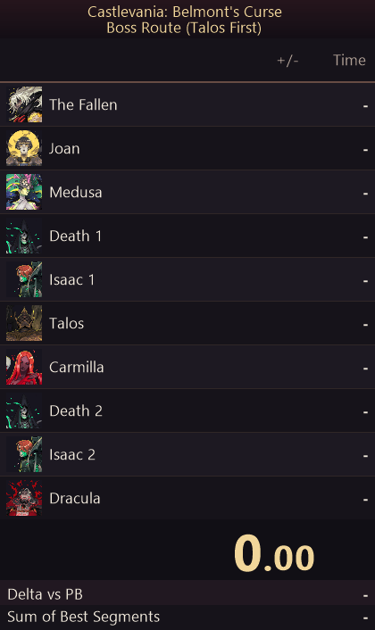
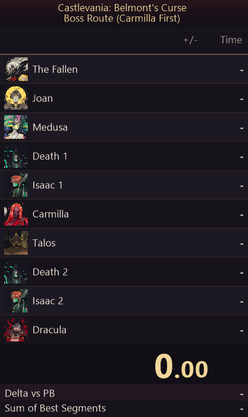

# Castlevania: Belmont's Curse — LiveSplit

A ten-boss autosplitter with **two route orders**, **first-movement auto-start**, **loading-screen removal**, and a compact layout with embedded boss portraits.

| Talos first | Carmilla first |
| :---: | :---: |
|  |  |

## Included files

| File | Purpose |
| --- | --- |
| [BelmontsCurse-Bosses.asl](BelmontsCurse-Bosses.asl) | Detects movement, boss defeats, and loading screens. |
| [BelmontsCurse-Bosses-MovementStart.lsl](BelmontsCurse-Bosses-MovementStart.lsl) | Ready-to-load layout with the autosplitter component. |
| [BelmontsCurse-Bosses-Talos-First.lss](BelmontsCurse-Bosses-Talos-First.lss) | Talos → Carmilla route with embedded portraits. |
| [BelmontsCurse-Bosses-Carmilla-First.lss](BelmontsCurse-Bosses-Carmilla-First.lss) | Carmilla → Talos route with embedded portraits. |

Both routes use the same script and layout. The script detects the route from the loaded split names; there is no route checkbox. Keep the supplied boss names and order. To switch routes, reset the timer, then load the other `.lss` before creating a new save.

## Setup

1. Select **Code → Download ZIP** on GitHub and extract it into a permanent folder. Keep the script, layout, and route files together.
2. In LiveSplit, right-click **Open Splits → From File** and choose either `BelmontsCurse-Bosses-Talos-First.lss` or `BelmontsCurse-Bosses-Carmilla-First.lss`. Both are blank routes with no recorded times; keep your own `.lss` if it contains PBs you want to preserve.
3. Right-click **Open Layout → From File** and choose `BelmontsCurse-Bosses-MovementStart.lsl`.
4. Open **Edit Layout**, double-click **Scriptable Auto Splitter**, and browse to the **updated `BelmontsCurse-Bosses.asl` from this download**, even if a path is already shown. Older fixed-order scripts do not support Carmilla first. Keep **Starting** and **Splitting** enabled, then save the layout.
5. Load the layout and reset the timer **before creating a new save**. Creating that save arms auto-start; your first directional movement starts the timer once gameplay controls become available. Keyboard and controller movement both work.
6. Reset manually between attempts, then create another new save. The normal Start/Split hotkey remains available.

## Timing behavior

- **Auto-start:** a newly created save arms the timer. Holding a direction through the opening starts timing when the game first accepts movement. Jump or attack alone does not start it.
- **Existing saves:** loading an existing save does not arm or start the timer. Attaching during an already-created new-save intro does not trigger a late start.
- **Game Time:** loading screens pause the clock automatically. Normal menus do not pause it. The script and included layout use Game Time; LiveSplit also records Real Time.
- **Boss splits:** each boss splits when its live defeat flag appears. Keep the ten names and order of your selected route and keep the timer running during boss defeats. Previously defeated bosses are ignored when attaching or starting. Other route orders are not supported.
- **Reset:** resets remain manual. Resetting on the same save does not rearm auto-start; create another new save for the next attempt.

## Boss order

| # | Talos first | Carmilla first |
| --- | --- | --- |
| 1 | The Fallen | The Fallen |
| 2 | Joan | Joan |
| 3 | Medusa | Medusa |
| 4 | Death 1 — Catacombs | Death 1 — Catacombs |
| 5 | Isaac 1 — first encounter | Isaac 1 — first encounter |
| 6 | **Talos** | **Carmilla** |
| 7 | **Carmilla** | **Talos** |
| 8 | Death 2 | Death 2 |
| 9 | Isaac 2 | Isaac 2 |
| 10 | Dracula — final beast form | Dracula — final beast form |

Dracula's first-form defeat does not finish the run. Splits follow the game's defeat flags, which may appear after a defeat animation.

## Compatibility and validation

Built for the verified **Steam 1.1.3** game binary and **LiveSplit 1.8.25 on 64-bit Windows**. The script locates the running game automatically and is self-contained; it reads memory without modifying the game or saves. All portraits are embedded in each splits file.

The script checks `GameAssembly.dll` before using its offsets. A changed game binary requires an updated script.

Both route orders passed ten-boss checks in LiveSplit's native ASL engine, along with movement-start and loading-pause checks. The route files and all portraits were also loaded and rendered with LiveSplit. A complete live ten-boss run has not been tested, so try the next boss in a practice run before relying on it for a PB.
